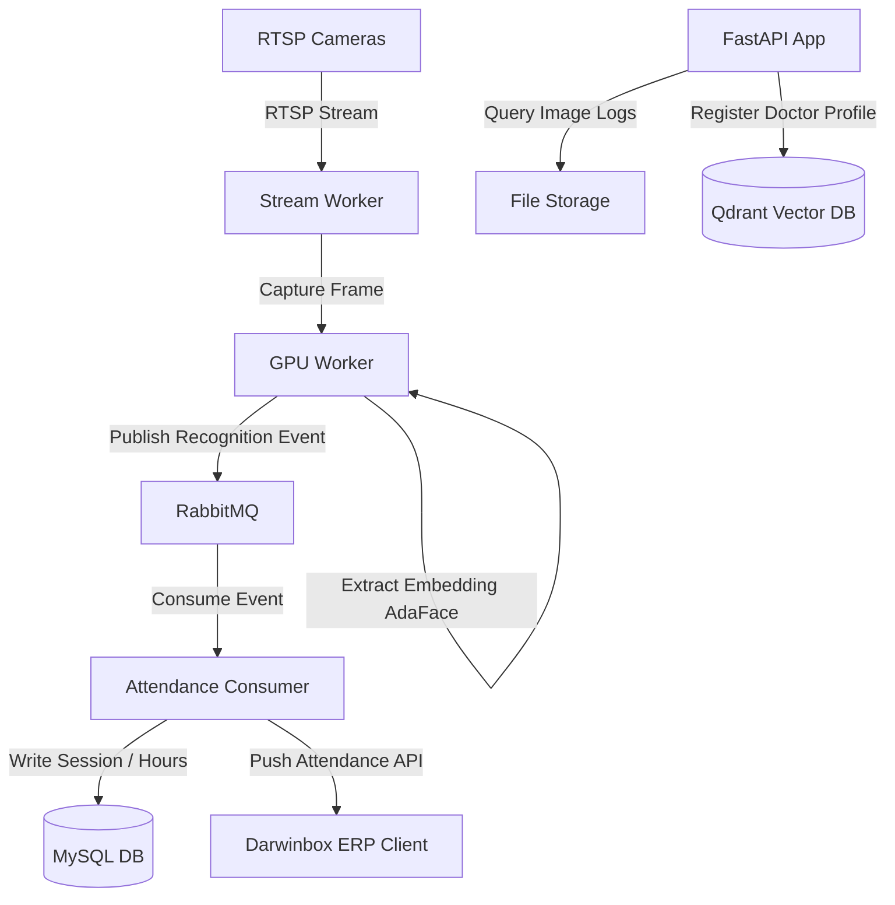

# GPU-Accelerated Face Recognition Attendance System

A high-performance, containerized, and production-ready attendance system utilizing state-of-the-art face detection and recognition models. This system leverages **FastAPI** for API endpoints, **SCRFD** (via InsightFace) for robust 5-point landmark face detection and alignment, **AdaFace** for deep face feature embedding, **Qdrant** for high-speed vector similarity search, and **RabbitMQ** for reliable asynchronous event processing.

---

## Architecture Overview



---

## Features

- **High-Speed Detection & Recognition**: Utilizes GPU acceleration (Nvidia CUDA) for real-time video stream decoding and batch face embedding extraction.
- **Robust Landmark Alignment**: Detects faces using SCRFD and performs 5-point affine transformation alignment to `112x112` dimensions before generating embeddings.
- **Asynchronous Decoupling**: Captures and processes frames in distinct GPU workers, publishing recognition events to RabbitMQ queues to prevent main execution thread blocking.
- **Stateful Session Tracking**: Calculates dynamic check-in (Entry) and check-out (Exit) sessions, computes total hours worked, and automatically closes active sessions.
- **ERP Integration**: Synchronizes attendance records to external ERP system (Darwinbox) dynamically.
- **Containerized Deployment**: Ready for one-click setup using Docker Compose with GPU runtime configurations.

---

## Project Structure

```text
├── app/
│   ├── api/                  # API routes and controllers
│   │   └── v1/
│   │       ├── endpoints/    # Camera routes, health, logs, upload profiles
│   │       └── __init__.py
│   ├── core/                 # Core settings, database connection configuration
│   │   ├── config.py
│   │   ├── gpu.py
│   │   └── logging_config.py
│   ├── db/                   # Database handler classes (MySQL and Qdrant)
│   │   ├── attendance_handler.py
│   │   ├── camera_db.py
│   │   ├── mysql_db.py
│   │   └── qdrant_service.py
│   ├── models/               # Model weights and loader utilities
│   │   └── load_yolo_model.py
│   ├── schemas/              # Pydantic schemas for request validation
│   ├── scripts/              # Independent startup consumers and indexers
│   │   ├── embeddings.py
│   │   ├── publisher_singleton.py
│   │   ├── qdrant_search.py
│   │   ├── rabbitmq_consumer.py
│   │   └── rabbitmq_publisher.py
│   ├── services/             # Core worker routines (GPU/Stream management)
│   │   ├── attendance_consumer.py
│   │   ├── embedding_utils.py
│   │   ├── face_recognition_manager.py
│   │   ├── gpu_worker.py
│   │   ├── health_service.py
│   │   ├── store_embedding.py
│   │   ├── stream_worker.py
│   │   └── tracker.py
│   ├── utils/                # Facial augmentations and helpers
│   └── training/             # Placeholders for training routines
├── Dockerfile                # Multi-stage GPU-enabled container definition
├── docker-compose.yml        # Orchestration script for Qdrant, RabbitMQ, and API
├── requirements.txt          # Python packages list
├── process_stream.py         # RTSP stream camera debug command-line utility
└── .env.example              # Template for environment configuration
```

---

## Installation & Setup

### Prerequisites
- **Docker** and **Docker Compose**
- **Nvidia Container Toolkit** installed (for GPU-accelerated inference)
- **Python 3.11** (if running bare-metal/locally)

### Environment Configuration
1. Clone this repository.
2. Copy the template environment configuration file:
   ```bash
   cp .env.example .env
   ```
3. Open `.env` and fill in your camera RTSP addresses, MySQL server details, RabbitMQ username/password, and external API endpoint configurations.

### Running with Docker Compose (Recommended)
Launch the full stack (FastAPI application, RabbitMQ broker, Qdrant Vector database, and background consumers):
```bash
docker-compose up --build -d
```

### Running Locally / Bare-Metal
1. Initialize a Python virtual environment:
   ```bash
   python3 -m venv .venv
   source .venv/bin/activate
   ```
2. Install dependencies:
   ```bash
   pip install --upgrade pip
   pip install -r requirements.txt
   ```
3. Run the FastAPI application:
   ```bash
   uvicorn main:app --host 0.0.0.0 --port 8000
   ```
4. Run the RabbitMQ consumer in a separate terminal:
   ```bash
   python -m app.services.attendance_consumer
   ```

---

## Configuration Variables

| Variable Name | Description | Default / Example |
|---|---|---|
| `MYSQL_HOST` | Host address of the MySQL database | `localhost` |
| `QDRANT_HOST` | Host address of the Qdrant database | `qdrant` |
| `RABBITMQ_HOST`| Host address of the RabbitMQ broker | `rabbitmq` |
| `CORS_ORIGINS` | Comma-separated allowed CORS origins | `http://localhost:5103` |
| `CAMERA_IP_1` | RTSP endpoint camera 1 | `192.168.1.100` |
| `CAMERA_USERNAME`| RTSP stream username | `admin` |
| `TIMEZONE` | System timezone for logs and database records | `Asia/Kolkata` |

---

## Troubleshooting

### Camera Unresponsive / Stream Issues
- Run the debug utility to test connection to a camera:
  ```bash
  python process_stream.py --ip YOUR_CAMERA_IP --username YOUR_USER --password YOUR_PASS --duration 60
  ```
  This will record a short stream and verify FFMPEG capture capacity.

### GPU Memory Leak / Out of Memory (OOM)
- The application isolates GPU work inside `GPUWorker` subprocesses. If you hit OOM issues, check `nvidia-smi` to see if other processes are hogging GPU memory.
- Adjust batch size limits and thread worker counts in `app/services/gpu_worker.py`.

---

## License

This project is licensed under the MIT License - see the [LICENSE](LICENSE) file for details.
